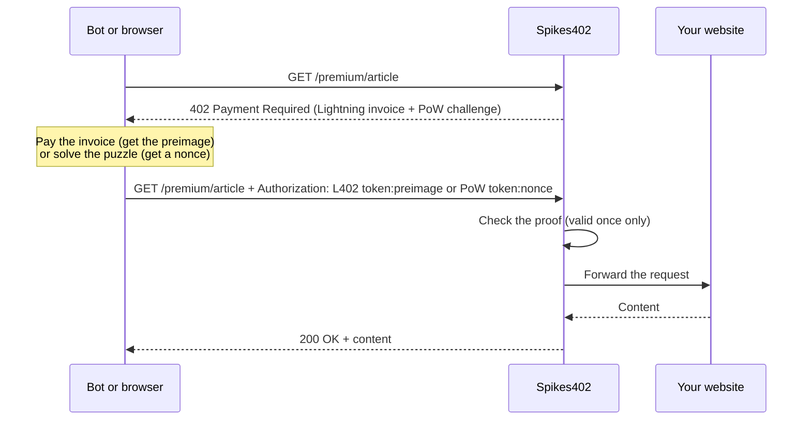
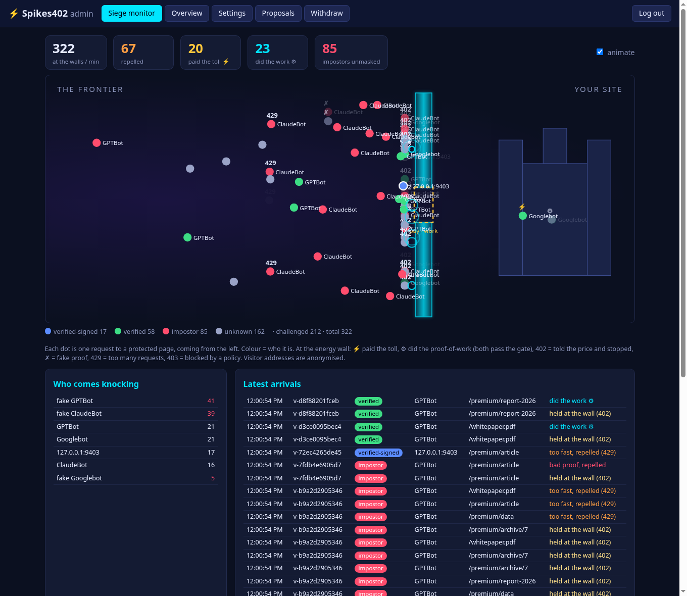

# Spikes402 — Pay or PoW

**Spikes402** is a small reverse proxy you put in front of a website. On the
paths you choose, AI bots and crawlers must either **pay** a few sats over
the Bitcoin Lightning Network ([L402](https://github.com/lightninglabs/L402))
or **do some work** (a proof-of-work puzzle, like Bitcoin mining in
miniature). Everything else passes through untouched.

> **Status: experimental.** This is a first prototype. Do not use it with
> real money on mainnet before an independent review.

- One request = one payment. No accounts, no subscriptions, no time passes.
- Non-custodial: payments go to *your own* Lightning node. Spikes402 never
  holds anyone's keys or funds.
- A single Go binary, two small dependencies (QR codes and `golang.org/x/crypto`
  for Argon2id), AGPLv3.
- Knows who is asking: bots that sign their requests
  ([Web Bot Auth](#bot-identification)) and well-known crawlers checked
  against their published IP lists. Impostors are flagged. By default
  everyone still pays the same price.
- Optional [admin dashboard](#admin-dashboard) with a live **siege monitor**,
  an [MCP server](#ai-admin-mcp) for an AI assistant, and optional
  [withdrawals](#withdrawals-optional-off-by-default) to one fixed address.

## How it works



Free paths are forwarded to your website directly, with no challenge.
Protected-path answers (the 402 itself, and the page after payment, work, a
pass, a pause, or a free policy) always go out with
`Cache-Control: private, no-store`, so a shared cache or CDN cannot serve a
paid page for free. Unprotected paths keep whatever `Cache-Control` your
website sets.

1. A request to a protected path without proof gets **HTTP 402**. The answer
   holds a signed **token**, a Lightning **invoice** for the price, and a
   **proof-of-work challenge** (the same token). A JSON body explains both
   options; browsers get a small page with a QR code instead. If a
   [WebLN](https://www.webln.guide/) wallet is in the browser, a "Pay with
   one click" button also appears, and the page tries to pay once on load
   with the invoice already shown (no second invoice). If the payment fits
   the wallet's budget, that can succeed without a further click. After
   paying, the page swaps the proof for a **pass**: a cookie (HttpOnly,
   SameSite=Strict, one page, 60 seconds) and then loads the page for real, so
   its CSS, images and scripts work, files download normally, and a reload
   within a minute does not pay again. Without WebLN the page is unchanged.
   (Paying with a QR code and an external wallet does not unlock the page yet;
   see "Known limits".)
2. **Pay:** paying the invoice reveals its *preimage*. The bot repeats the
   request with `Authorization: L402 <token>:<preimage>`. Spikes402 checks
   that `sha256(preimage)` equals the payment hash inside the token.
3. **Or work:** the bot finds a number `nonce` such that
   `SHA256(SHA256(token + ":" + nonce))` starts with `difficulty` zero bits,
   and sends `Authorization: PoW <token>:<nonce>`.
4. Each token is **bound to one resource** (method + path + query), **expires**
   (10 minutes by default) and can be **used once**, by either route.

## Quick start (fake Lightning, no real money)

You need [Go](https://go.dev/dl/) 1.26 or newer (builds use Go 1.27.4 or
later, which has the latest security fixes; `go` downloads it if needed).

```sh
git clone https://github.com/Choffolo/spikes402 && cd spikes402
go build -o bin/ ./cmd/...
bin/demo-origin & bin/spikes402 -config config.example.json & sleep 1
bin/spikes-bot -mode pow http://localhost:8402/premium/article
```

This starts a stand-in website on port 8080, the proxy on port 8402 in front
of it, and then the example bot. Stop the servers with `kill %1 %2`.

Expected output:

```
bot: GET http://localhost:8402/premium/article
bot: 402: solving sha256d proof-of-work (difficulty 24, ~8.4 s on one CPU core)...
bot: 402: solved, nonce=8717585
bot: 200 OK in 949ms
bot: the site classified us as: unknown
Premium content at /premium/article. Thank you for paying (or working)!
```

Try `-mode pay` to pay with the fake wallet instead, `curl -i
http://localhost:8402/premium/article` to see the raw 402 answer, or open
that URL in a browser to see the payment page.

## Configuration

A JSON file (see [`config.example.json`](config.example.json)):

| Key | Meaning | Default |
|---|---|---|
| `listen` | Address the proxy listens on | `":8402"` (`"127.0.0.1:8402"` with the fake backend) |
| `origin` | The website to protect (`http://` or `https://` URL) | required |
| `price_sats` | Default price of one request, in satoshis (used when no `prices` rule matches) | required, ≥ 1, at most 1,000,000 |
| `prices` | Optional list of `{ "pattern", "price_sats" }` rules. Same pattern syntax and canonical path as `protect`. **The first matching rule wins**; put more specific patterns first. Unmatched protected paths use `price_sats`. | `[]` |
| `protect` | Path patterns that require payment. `"/premium/**"` = everything under `/premium`; other patterns use [glob syntax](https://pkg.go.dev/path#Match), e.g. `"/*.pdf"`. See [Path matching](#path-matching) | required |
| `protect_case_sensitive` | Match `protect` patterns with exact letter case. Off by default, because many websites serve `/Premium` like `/premium` | `false` |
| `pow_seconds_per_sat` | How much work replaces one sat: seconds of one CPU core (see [Proof-of-work pricing](#proof-of-work-pricing)) | `10` |
| `pow_difficulty` | Leading zero bits for the puzzle. `0` = derive from the price and `pow_seconds_per_sat` | `0` |
| `pow_algorithm` | `"sha256d"` or `"argon2id"` (memory-hard, see [Argon2id](#argon2id-memory-hard-proof-of-work)) | `"sha256d"` |
| `argon2_memory_mib` | Memory per Argon2id attempt, 8–256 MiB | `16` |
| `argon2_max_memory_mib` | Memory all concurrent Argon2id checks may use together. A check that needs more than this is refused at startup. Extra checks wait briefly, then `503` | `256` |
| `challenge_ttl_seconds` | How long a 402 offer (token and invoice) stays valid | `600` |
| `challenges_per_minute` | 402 answers per client per minute; beyond that, `429 Too Many Requests` | `30` |
| `max_invoices_per_minute` | Invoices created per minute, all clients together; beyond that, proof-of-work only | `300` |
| `max_pending_invoices` | Open (unpaid, unexpired) invoices at once; beyond that, proof-of-work only | `10000` |
| `client_ip_header` | Header holding the visitor's IP when Spikes402 runs behind your own proxy, e.g. `"X-Forwarded-For"`, `"X-Real-IP"`, `"CF-Connecting-IP"` | `""` (use the connection's address) |
| `trusted_proxies` | IPs or CIDR ranges of those proxies, e.g. `["127.0.0.1"]`. The header is ignored from anyone else. Required with `client_ip_header` or `preserve_host` | `[]` |
| `preserve_host` | Send the public `Host` (or `X-Forwarded-Host`) to the origin, for name-based virtual hosts. Only from `trusted_proxies`; if `public_hosts` is set, only those names are forwarded. Off: the origin sees the host of `origin` | `false` |
| `max_connections` | Client connections open at once; more wait in the queue | `10000` |
| `read_timeout_seconds` / `write_timeout_seconds` | Longest time to receive a whole request / send a whole response (raise the second for very large downloads or streaming) | `60` / `300` |
| `unsafe_allow_dangerous_config` | Accept settings refused by default: `trusted_proxies` or `admin.allowed_ips` covering the whole internet (`0.0.0.0/0`, `::/0`), or the fake backend on a non-localhost address | `false` |
| `secret_key` | Signs tokens, ≥ 32 characters. Better set via `SPIKES402_SECRET_KEY` | random with `fake`, required otherwise |
| `identify_bots` | Classify clients (Web Bot Auth, published IP lists, reverse DNS); see [Bot identification](#bot-identification) | `true` |
| `known_bots` | Replace the built-in list of crawlers: `[{"name", "user_agent", "ip_ranges_url", "reverse_dns": [...]}]` | built-in list |
| `paused` | Serve protected paths free and create no invoices (dashboard toggle; also honoured in the file / overrides) | `false` |
| `bot_policies` | Optional per-class treatment (see [Policies](#policies-off-by-default-open-for-discussion)) | `{}` = everyone pays the same |
| `web_bot_auth_trusted_agents` | Domains whose Web Bot Auth key directories you trust, e.g. `["chatgpt.com"]` (subdomains included). Only those signatures make a request `verified-signed`; see [Web Bot Auth](#web-bot-auth) | `[]` = none |
| `public_hosts` | Your site's host names, e.g. `["example.com", "www.example.com"]`. Signatures made for any other host are refused. Required with `web_bot_auth_trusted_agents` | `[]` |
| `web_bot_auth_dev_mode` | Accept key directories on `http://`, localhost and any port, and signatures over plain http. **Testing only**; refused with a real Lightning backend | `false` |
| `admin.key` | Turns on the [admin dashboard](#admin-dashboard), ≥ 32 characters. Better set via `SPIKES402_ADMIN_KEY` | `""` = off |
| `admin.listen` | Address of the dashboard/API, separate from the proxy | `"127.0.0.1:8404"` |
| `admin.allowed_ips` | IPs/CIDRs allowed to reach the dashboard besides localhost. Required if `admin.listen` is not localhost | `[]` |
| `admin.ai_key` | Separate key for the [AI admin (MCP)](#ai-admin-mcp). Better set via `SPIKES402_AI_KEY` | `""` = no AI |
| `admin.ai_can_apply` | Let the AI apply changes itself instead of only proposing them | `false` |
| `admin.visitor_ips` | How visitors appear in the siege monitor: `"hash"`, `"truncate"` (/24, /48) or `"full"` | `"hash"` |
| `withdraw.*` | See [Withdrawals](#withdrawals-optional-off-by-default) | off |
| `lightning.backend` | `"fake"` (development) or `"phoenixd"` | required |
| `lightning.phoenixd_url` | phoenixd HTTP API | `"http://127.0.0.1:9740"` |
| `lightning.phoenixd_password` | phoenixd *limited-access* password. Better set via `PHOENIXD_PASSWORD` | — |

Unknown keys are rejected, so typos are caught at start-up.

### Path matching

A protected page must not be reachable under another spelling, whatever
web server sits behind Spikes402. So:

- Request targets longer than 8 KiB get `414 URI Too Long`, and request
  headers are capped at 32 KiB.
- Paths that servers read differently are refused with `400 Bad Request`:
  dot segments and double slashes (`/a/../b`, `//b`), encoded slashes,
  backslashes and percent signs (`%2F`, `%5C`, `\`, `%25`, so no double
  encoding), and control characters (`%00`, tabs, line breaks).
- Patterns are matched ignoring letter case (unless `protect_case_sensitive`),
  `;parameters` in a segment (`/premium;x/a`, `/x/..;/premium`), trailing dots
  and spaces in a segment (`/premium./a`) and a trailing slash. All of these
  are asked to pay; the request is forwarded unchanged.
- `prices` uses this same matching. Example: articles cost 5 sats, premium
  20, a narrower premium folder 1 (listed first so it wins), everything
  else that is protected uses `price_sats`:

  ```json
  "protect": ["/articles/**", "/premium/**"],
  "price_sats": 5,
  "prices": [
    {"pattern": "/premium/special/**", "price_sats": 1},
    {"pattern": "/premium/**", "price_sats": 20}
  ]
  ```

  The signed L402 token records the price it was issued for, and is bound to
  the exact method and URL. If you raise a price, an invoice that was already
  paid is still honoured at the old price until its token expires
  (`challenge_ttl_seconds`). A proof-of-work token is not: its difficulty was
  set for the old price, so it must cover the new one.

## Proof-of-work pricing

The puzzle should cost a bot something comparable to the price, so the
difficulty is derived from it (from this request's price, including a
matching `prices` rule, not only from the default `price_sats`):

```
difficulty = round(log2(price_sats × pow_seconds_per_sat × 2,000,000))   clamped to 16…32 bits
```

If you set `pow_difficulty` yourself (not 0), every path uses that fixed
difficulty, whatever the sats price.

**Assumption:** one commodity CPU core does about **2 million** puzzle
attempts per second (we measured ~2.7 million on a recent server core;
the figure is rounded down). A gaming GPU is roughly **1000×** faster. The
402 answer tells bots the expected time as `expected_seconds_one_cpu_core`.
An optimised native solver (for example in Rust) is about **1.5×** faster
than this Go reference for sha256d and about **1.3×** for argon2id, in an
external benchmark; expected times for those solvers are shorter. The
published calibration is unchanged.

With the default `pow_seconds_per_sat: 10`:

| Price | Difficulty | One CPU core (average) | GPU (roughly) |
|---|---|---|---|
| 1 sat | 24 bits | ~8 s | ~0.01 s |
| 10 sats | 28 bits | ~2 min | ~0.1 s |
| 100 sats | 31 bits | ~18 min | ~1 s |
| 1000 sats | 32 bits (max) | ~36 min | ~2 s |

Why 10 seconds per sat: a rented CPU core costs about $0.02 per hour, and at
$100,000 per bitcoin one sat is $0.001, the price of about **3 minutes** of
that core. Exact cost parity (`pow_seconds_per_sat: 180`) would make the puzzle
unusable for CPU-only bots, so the default is about 20× cheaper than paying,
while still making mass scraping slow. Raise it if you want work to cost as
much as paying. Specialised hardware will always be relatively cheaper: GPUs
are far faster, and that is accepted. Bitcoin mining ASICs, as far as we
know, are built for 80-byte block headers and cannot directly solve this
puzzle. The 32-bit cap keeps prices above ~1000 sats from producing puzzles
no CPU bot would attempt; set `pow_difficulty` explicitly to go beyond it.

### Argon2id (memory-hard proof-of-work)

With `"pow_algorithm": "argon2id"` the puzzle is
`Argon2id(token + ":" + nonce, salt "spikes402-pow-v1", 1 pass, argon2_memory_mib MiB, 1 lane, 32 bytes)`
with `difficulty` leading zero bits. Each attempt has to fill and read that
much memory, so a GPU or ASIC gains much less over an ordinary CPU than with
sha256d (commonly a single-digit factor per dollar instead of ~1000×; we
have not measured it ourselves). The default stays sha256d because each
check is cheap for the server.

**Pricing.** Same idea as above, with a different speed: one CPU core
processes about **1,500 MiB of Argon2id per second** (we measured ~1,900
MiB/s at 16–64 MiB, rounded down), so one 16 MiB attempt takes ~11 ms:

```
difficulty = round(log2(price_sats × pow_seconds_per_sat ÷ (argon2_memory_mib ÷ 1500)))   clamped to 1…20 bits
```

| Price (`pow_seconds_per_sat: 10`) | 16 MiB | 64 MiB | One CPU core (average) |
|---|---|---|---|
| 1 sat | 10 bits | 8 bits | ~11 s |
| 10 sats | 13 bits | 11 bits | ~1.5 min |
| 100 sats | 17 bits | 15 bits | ~23 min |

More memory means fewer, slower attempts for the same price: it favours
machines with lots of RAM per core less than a smaller setting does, but
costs the server more per check.

**Protecting the server.** Checking a solution costs the server one attempt
(16 MiB and ~10 ms by default), so Spikes402 only runs Argon2id for a
token it signed itself, for this page, not expired and not used yet (all
cheap checks done first). Each check also counts against the client's
`challenges_per_minute`. Concurrent checks share a memory budget
(`argon2_max_memory_mib`, default 256 MiB): at the default 16 MiB per
check that is 16 at once; at 256 MiB per check, only one. A config where
one check needs more than the budget is refused. If the budget is full,
the caller waits briefly and then gets `503` + `Retry-After: 1`, and the
token stays valid. A wrong answer **burns the token** (one check per token,
ever). The parameters are inside the signed token, so a client cannot pick
cheaper ones.

**Future option:** [RandomX](https://github.com/tevador/RandomX) (Monero's
CPU-oriented PoW) narrows the gap to specialised hardware even further, but
it needs ~256 MiB per verifier and a C library. Not implemented.

## Bot identification

On protected paths Spikes402 tries to tell who is asking, logs it (at most
60 lines a minute) and tells the client in a response header:

```
Spikes402-Class: verified-signed; name="https://bot.example/.well-known/http-message-signatures-directory"; method=web-bot-auth
Spikes402-Class: verified; name="Googlebot"; method=ip-list
Spikes402-Class: impostor; name="GPTBot"; method=ip-list
Spikes402-Class: unknown
```

| Class | Meaning |
|---|---|
| `verified-signed` | The request carries a valid **Web Bot Auth** signature (below). Checked first |
| `verified` | The User-Agent claims a known crawler and the address checks out against the operator's published IP list (or, where no list is loaded yet, forward-confirmed reverse DNS) |
| `impostor` | The User-Agent claims a known crawler but the address definitely does not belong to it |
| `unknown` | Everything else, including claims that could not be checked (DNS timeout, list not loaded); a `note` says why |

Built-in crawlers (IP lists refreshed daily, kept on failure): Googlebot,
Bingbot, GPTBot, OAI-SearchBot, ChatGPT-User, ClaudeBot, PerplexityBot,
Perplexity-User, Applebot, DuckDuckBot, CCBot. Replace the list with
`known_bots`. Reverse DNS has a 1.5 s timeout, at most 16 lookups at once
and a cache of 10,000 addresses.

### Web Bot Auth

[Web Bot Auth](https://datatracker.ietf.org/wg/webbotauth/about/) lets a
bot sign each request with [HTTP Message Signatures (RFC 9421)](https://www.rfc-editor.org/rfc/rfc9421)
and publish its public keys at
`https://<its domain>/.well-known/http-message-signatures-directory`. The
request names that URL in a `Signature-Agent` header. Spikes402 follows
[draft-ietf-webbotauth-httpsig-protocol](https://datatracker.ietf.org/doc/draft-ietf-webbotauth-httpsig-protocol/)
and checks the draft's own test vectors. Ed25519 only, using Go's standard
`crypto/ed25519`.

Where the drafts leave room, Spikes402 takes the **strict** reading:

- The signature must cover `@authority` (or `@target-uri`) and the
  `signature-agent` header member, carry `created`, `expires`, `keyid` (the
  key's JWK thumbprint) and `tag="web-bot-auth"`, and be valid for at most
  **1 hour** (the draft allows 24 h); 1 minute of clock skew is tolerated.
- Only these components can be signed: `@method`, `@authority`, `@scheme`,
  `@target-uri`, `@request-target`, `@path`, `@query`, plain headers and
  `signature-agent`. Anything else makes the signature "unverified".
- **Replay protection:** a signature (its nonce, or the signature itself) is
  accepted once. The memory for this is capped at 100,000 entries; when full,
  signatures count as unverified rather than risk a replay.
- Signatures only count over **https** (directly or via a trusted proxy that
  sets `X-Forwarded-Proto: https`).
- **Key directories** are fetched only from `https://` on port 443, never
  from private, loopback or link-local addresses (no SSRF), without
  redirects, in at most 5 s and 64 KiB, with at most 32 keys, and the media
  type must be `application/http-message-signatures-directory+json`. They are
  cached per `Cache-Control` (5 min – 24 h; failures for 1 min). If a refresh
  fails, the keys already known stay valid for up to 24 h. At most 1,000
  directories are cached and 30 new fetches a minute are made.
- The draft's **published test key is refused**, as the draft asks.
- The first request from a new bot may wait up to 1.5 s for its directory;
  if it is not there in time the request counts as "unverified".
- A bad or unverifiable signature does not block anything: the request is
  classified by the other checks, with a note.
- **Anyone can publish a key**, so a valid signature alone proves nothing
  about *who* signed. A request is only `verified-signed` if the key
  directory is on a domain listed in `web_bot_auth_trusted_agents` (or a
  subdomain of one). Other valid signatures are noted and the request is
  classified by the other checks. With the default empty list, nobody is
  `verified-signed`.
- **No relaying:** with `public_hosts` set, a signature only counts if the
  request's host is one of your host names, so a signature a bot made for
  another site cannot be replayed against yours.

### Policies: off by default, open for discussion

Should verified or signed bots pay less, more, or nothing at all? We do
not know yet. So **by default every client pays the same price, verified or
not** (no free pass, multiplier 1); identification is used for logs,
transparency and spotting impostors.

For those who want to experiment, `bot_policies` maps a class (`unknown`,
`impostor`, `verified`, `verified-signed`), a bot name (`"GPTBot"`) or a Web
Bot Auth directory URL to an action:

```json
"bot_policies": {
  "impostor": {"action": "pow-only"},
  "verified": {"action": "pay", "price_multiplier": 2}
}
```

Actions are `pay` (normal), `pow-only` (no invoice), `free` and `block`
(403). `price_multiplier` scales the price and the puzzle (minimum 1 sat).
Bot names and URLs only match once verified, so an impostor never gets a
named bot's treatment, and `verified-signed` only covers agents on your
`web_bot_auth_trusted_agents` domains. Note that a bot can always drop its claim and be
`unknown`, so a policy for `unknown` is the effective floor.

## Protecting your Lightning node

The paywall must never become a way to flood your node with invoice
requests. Every unpaid request gets a proof-of-work challenge, which costs
the server almost nothing. An invoice is only added when *all* of these
allow it; otherwise the 402 answer offers proof-of-work only and the node is
not called:

| Guard | Default | What it stops |
|---|---|---|
| Per-client limit: `challenges_per_minute` per IP (per /64 for IPv6) | 30 | One client hammering the paywall. Beyond it: `429 Too Many Requests` + `Retry-After`. Free pages are never limited |
| Same offer reused for the same client and page while more than half its lifetime is left. "Same client" means same IP **and** same `spikes402_session` cookie (see below) | on | Reloads creating new invoices |
| Global rate: `max_invoices_per_minute`, spread evenly (bursts up to 5 seconds' worth) | 300 | Many clients at once (botnets) |
| Global cap: `max_pending_invoices` open at once | 10,000 | Unpaid invoices piling up |
| At most 8 invoice requests in flight, each with a 3-second timeout | on | A slow node tying up the proxy |
| Circuit breaker: after 5 failures in a row, the node is left alone for 30 s; after that a single failure pauses it again | on | Hitting a node that is already struggling |

A visitor hanging up mid-request does not count as a node failure, so
nobody can trip the breaker on purpose. Failures are logged at most once a
minute.

**Session cookie.** 402 answers set an optional cookie, `spikes402_session`
(random value, `HttpOnly`, `SameSite=Lax`, `Secure` over https, 24 h). A
client that sends it back gets its open offer again instead of a new
invoice. A client without it (most bots) gets a fresh offer on each
request, still counted by every guard above, so the node is not called more.
Two clients behind the same IP (office, carrier NAT) therefore never share
an offer, and nobody can use up an invoice someone else is paying. The cookie
is removed before the request goes to your website. Even so, a paid invoice
can always be used once by whoever paid it: if the offer's puzzle was solved
first, the payment still unlocks the page once (work after a payment is refused).

**Real client IPs.** Behind a reverse proxy or CDN, every request seems to
come from the proxy. Set `client_ip_header` *and* `trusted_proxies`: the
header is only believed on connections from those addresses. It is read
from right to left, skipping trusted proxies, so a fake address a client
puts at the start of `X-Forwarded-For` is ignored. The same rule applies
when forwarding to your website: `X-Forwarded-*` and the client-IP header
are kept or appended only from a trusted proxy; any other peer's spoofed
headers are stripped and replaced with the connection address. By default
the `Host` sent to the origin is the host of `origin`. Set `preserve_host`
if your website is a name-based virtual host and must see the public host
name; that only applies to trusted proxies, and if `public_hosts` is set,
only those names are forwarded.

**Bounded memory.** Rate-limit windows, open offers and used tokens are
evicted when they expire. Hard caps also apply: 100,000 tracked clients per
minute (newcomers beyond that share one allowance), `max_pending_invoices`
offers, and 1,000,000 used tokens. When the used-token list is full, new
redemptions are refused ("server busy") rather than risking a replay.

## Admin dashboard

Off by default. Set an admin key and restart:

```sh
export SPIKES402_ADMIN_KEY=$(openssl rand -hex 32)
bin/spikes402 -config config.json
# then open http://127.0.0.1:8404 and paste the key
```

The dashboard listens on its **own address, localhost only by default**,
never on the public proxy port. From another computer use an SSH tunnel
(`ssh -L 8404:127.0.0.1:8404 your-server`), or set `admin.listen` plus
`admin.allowed_ips` (only the TCP address counts, never forwarded headers).
The key is compared in constant time, kept only in the browser tab
(`sessionStorage`) and sent as `Authorization: Bearer`, so there are no cookies
to steal or forge. The page is plain HTML/JS embedded in the binary, with a
strict Content-Security-Policy and no outside resources.

It is **one page**: the siege monitor (below), four numbers and a small
Lightning light (green = fine, red = a problem; hover it for details).
Everything else sits behind the discreet **Settings** link:

- the few **webmaster settings** that can change while running: `price_sats`,
  `prices` (per-path rules; first match wins), `protect`, `pow_seconds_per_sat`,
  `challenges_per_minute`, `bot_policies` (the four visitor classes as
  dropdowns) and `paused`. They are validated like the config file, apply
  immediately, and are saved to a sidecar file next to the config
  (`config.overrides.json` when the config is `config.json`). `config.json`
  itself is never rewritten. The overrides file is written atomically, mode
  `0600`, and contains only those dashboard fields (unknown keys, including
  secrets or Lightning settings, are refused on load). On start, overrides
  win over the same fields in `config.json`. Delete the overrides file if you
  want the config file values back. Everything about money or the perimeter
  stays in the config file on purpose: passwords and keys, the Lightning
  node, the withdraw destination, node anti-flood limits
  (`max_invoices_per_minute`, `max_pending_invoices`), ports, trusted
  proxies / IP header, and admin allowed IPs. A stolen admin key can change
  prices, protection and pause, but cannot drain or flood the node.
  **Pause** serves protected paths free and creates no invoices at all
  (no load on the node). Only the human admin can toggle it; the AI key
  may propose a pause but cannot apply it, even when `admin.ai_can_apply`
  is on. A collapsed list shows all current settings (no secrets) and node details;
- **AI proposals**: changes suggested by the AI admin, to approve or reject;
- **Withdraw**, in its own red box at the bottom, only if enabled.

### Siege monitor



Every request to a protected page is a dot walking from the left to the
glowing wall in front of your site. Four colours, matching the four numbers:

- **gold**: paid ⚡ (passes the gate into the site)
- **cyan**: did the proof-of-work (passes too)
- **grey**: stopped at the wall, told the price (`402`)
- **red**: repelled (fake proof, too fast `429`, busy `503`, blocked `403`)

On top: visits per minute, paid, proof-of-work and repelled. Hover a dot to
see who it is (`GPTBot`, `Googlebot (fake)`, …); names are written next to
the dots only when few are on screen. "Last 10 visits" opens a small table.

It polls the API once a second; nothing is pushed when nobody watches. The
server keeps only the **last 1,000 visits** in a ring buffer plus counters
(at most 200 bot names; the full breakdown by class, outcome and bot is in
`GET /api/status` and the MCP tools). Visitors are **anonymised by default**:
a keyed hash that changes on every restart (`v-3fa2c1d9e07b`), no query
strings. Use `"admin.visitor_ips": "truncate"` for networks
(`203.0.113.0/24`) or `"full"` for addresses. The animation respects
"reduce motion".

## AI admin (MCP)

`bin/spikes402-mcp` is a [Model Context Protocol](https://modelcontextprotocol.io)
server (stdio) that lets an AI assistant (Claude Desktop, Cursor, …) watch the
proxy and suggest changes. Give it its **own key**, `admin.ai_key`:

```json
{"mcpServers": {"spikes402": {"command": "/path/to/bin/spikes402-mcp",
  "env": {"SPIKES402_AI_KEY": "<admin.ai_key>", "SPIKES402_ADMIN_URL": "http://127.0.0.1:8404"}}}}
```

Tools: `get_status`, `get_recent_visits`, `get_settings`, `list_proposals`,
`propose_settings_change` and `apply_settings_change`. With the AI key the API
allows reading and **proposing** only; a proposal changes nothing until you
approve it in the dashboard. Applying directly needs `"admin.ai_can_apply":
true` in the config file. The AI key can **never** approve proposals or
withdraw; there is no withdraw tool; and `spikes402-mcp` refuses to run with
the human admin key.

## Withdrawals (optional, off by default)

The dashboard can send money from the node to **one fixed destination**
written in the config file. It cannot be changed through the dashboard, the
API or the AI.

```json
"withdraw": {
  "enabled": true,
  "destination": "you@your-wallet.example",
  "feerate_sat_vbyte": 0
}
```

```sh
export SPIKES402_WITHDRAW_PASSWORD='a long passphrase, not the admin key'
export PHOENIXD_FULL_PASSWORD=<http-password from phoenix.conf>
```

- **Destination**: a Lightning address or a
  [BIP353](https://github.com/bitcoin/bips/blob/master/bip-0353.mediawiki)
  address (both look like `name@domain`; a leading `₿` is accepted and
  removed). phoenixd's `/paylnaddress` pays both: it tries BIP353 first,
  then the classic Lightning address (LNURL). Or a Bitcoin address
  (on-chain via `/sendtoaddress`, which needs `feerate_sat_vbyte`). A raw
  BOLT12 offer (`lno1…`) is not accepted as a destination (the donation
  offer below is for sending *to* this project, not for withdrawals).
- **Routing fee reserved**: for Lightning destinations the amount plus
  Phoenix's routing fee (4 sats + 0.4 %, rounded up) must fit in the balance;
  if it does not, the error tells you the largest amount you can withdraw.
- **Unknown outcome**: if phoenixd does not answer clearly (for example a
  timeout), the withdrawal is recorded as "unknown — check the node", not as
  failed, and new withdrawals are blocked. Check the node's outgoing payments
  (`phoenix-cli listoutgoingpayments` or the Phoenix logs), then click
  "It was sent" or "It was not sent" on the dashboard (withdraw password
  needed). This prevents paying twice.
- **⚠ phoenixd full-access password.** Withdrawing needs phoenixd's *full*
  `http-password`, which can spend everything on the node. It is only read
  when withdrawals are enabled and is used only by the withdrawal code; the
  paywall itself keeps using the limited, receive-only password. If you do not
  need withdrawals, leave them off and use phoenixd's own tools instead.
- **Two confirmations**: step 1 sends the amount and the withdraw password
  and returns a one-time confirmation valid for 2 minutes, showing the
  destination; step 2 needs the same amount and the password again (plus a
  browser confirm). Each confirmation works once.
- The **withdraw password** is separate from the admin key (≥ 16 characters,
  must differ from every other secret). After 5 wrong passwords withdrawals
  lock for 15 minutes. The admin key alone cannot withdraw.
- **Keep withdrawals off when you are not withdrawing.** While they are on,
  the internet-facing proxy holds a password that can spend everything, and
  it logs a warning at start-up. Safest: withdraw with phoenixd's own tools
  (`phoenix-cli`) and never enable this. See [SECURITY.md](SECURITY.md).
- Only the human admin key can withdraw; the AI key never can.

## Using a real Lightning node: phoenixd

[phoenixd](https://phoenix.acinq.co/server) is a minimal, self-hosted,
non-custodial Lightning node by ACINQ. Your keys stay on your server.

1. Install and start phoenixd on the same machine (see its documentation).
   On first start it writes `~/.phoenix/phoenix.conf` and a seed:
   **back up `~/.phoenix/seed.dat`**.
2. Copy `http-password-limited-access` from `phoenix.conf`. That password can
   create invoices but **cannot spend**, which is all Spikes402 needs.
3. Configure and run:

   ```sh
   export SPIKES402_SECRET_KEY=$(openssl rand -hex 32)
   export PHOENIXD_PASSWORD=<http-password-limited-access>
   # in your config: "lightning": {"backend": "phoenixd"}
   bin/spikes402 -config config.json
   ```

phoenixd gets inbound liquidity automatically; the first payments it
receives pay for opening its channel, so small amounts may not show up in
your balance straight away. Read phoenixd's docs on fees before going live.

To run the proxy and phoenixd with Docker, see [Deploying Spikes402](docs/deploy.md).

## For bot authors

`Authorization` formats and the JSON body are documented above and in every
402 answer. In Go you can use the [`client`](client) package:

```go
c := &client.Client{Mode: client.ModePoW}
resp, err := c.Get(ctx, "https://example.com/premium/article")
```

Paying needs a `client.Payer` (your wallet). Only a fake payer exists so far.
The client solves both `sha256d` and `argon2id` puzzles and refuses ones
that are too hard (`MaxDifficulty`, `MaxArgonDifficulty`, `MaxArgonMemoryMiB`).

**Signing your requests (Web Bot Auth).** Set `client.Signer` to a
`webbotauth.Signer` with your Ed25519 key and the https URL where you
publish your key directory (`webbotauth.DirectoryHandler` serves it). The
example bot can do it all:

```sh
bin/spikes-bot -sign -key-file bot.key -agent-url https://bot.example/.well-known/http-message-signatures-directory URL
# prints the key directory (JWKS) to publish at that URL

# local test: serve the directory from the bot itself (gate needs "web_bot_auth_dev_mode": true)
bin/spikes-bot -sign -serve-directory 127.0.0.1:8403 http://localhost:8402/premium/article
```

## Security notes

- **Single use, per resource, short-lived.** Tokens are HMAC-SHA256 signed and
  carry the payment hash, a hash of the resource, the expiry and the puzzle difficulty.
  A token cannot be reused, moved to another page, or forged without the
  secret key. Wrong attempts do not burn a valid token, except with Argon2id
  (see above).
- **Not real macaroons.** The `macaroon="…"` field holds this simpler signed
  token. The header layout follows L402, so clients that treat the token as
  an opaque string work; clients that decode macaroons (such as Lightning
  Labs' own tools) will not understand it yet. Caveats/delegation are not
  supported.
- **The secret key** must stay secret and stable: anyone who has it can mint
  tokens. Never commit it; use the environment variable.
- **Your credentials stay with you:** Spikes402 removes its own `Authorization`
  header and session cookie before forwarding to the origin and refuses
  ambiguous paths (see [Path matching](#path-matching)).
- **Dangerous settings are refused** unless `unsafe_allow_dangerous_config`
  is set: trusting every address as a proxy, opening the dashboard to the
  whole internet, or exposing the fake backend (with it, anyone can "pay").
- **Only receiving:** use phoenixd's limited-access password, never the full one.
- **Proof-of-work is cheaper on special hardware.** The difficulty is
  calibrated for a CPU core (see [Proof-of-work pricing](#proof-of-work-pricing));
  a GPU solves it about 1000× faster.
- **Client IP header:** it is only trusted from `trusted_proxies`; list only
  proxies you control. Spoofed `X-Forwarded-*` and client-IP headers from
  anyone else are stripped before the request reaches your website.
- **Admin dashboard:** keep it on localhost (default) and reach it through an
  SSH tunnel. Over plain http on a network the key could be sniffed; use
  `admin.allowed_ips` only on a network you trust, or put TLS in front.
- **Keys are separate:** admin key, AI key, withdraw password and phoenixd's
  two passwords must all differ; the config check refuses reused ones.

## Known limits / not done yet

- Pricing does not yet move between a min and a max with load. Today you
  set a default `price_sats` and, optionally, fixed per-path prices.
- Paying the invoice with a QR code and a wallet that is not in the browser
  does not unlock the page: the server cannot see the payment, and a person
  cannot send the `Authorization` header. Bots and WebLN wallets are fine.
- If your website fails to answer (a 5xx status or no answer) for a GET or HEAD
  that carried a valid proof, the same proof can be sent again: up to 3 times
  within 30 seconds, and it is delivered at most once. Other methods get no
  second try.
- Spent tokens are remembered in memory: about **128 MiB** at the cap of
  1,000,000 unexpired tokens (measured, ~134 bytes per entry). Run **one**
  proxy instance; a restart forgets them (tokens expire after
  `challenge_ttl_seconds`, so the replay window is limited to that).
- Rate limits are per IP. A botnet with many addresses can use up the global
  invoice budget; paying visitors then get proof-of-work only until it
  refills. The node itself stays protected. Bots behind one shared address
  (office, carrier NAT) share a limit (but never an offer).
- More security limits are listed in [SECURITY.md](SECURITY.md).
- The proof-of-work price is an estimate (see above), not a market price.
- If the site itself uses the `Authorization` header on protected paths,
  it will conflict with Spikes402.
- No real wallet in the example bot; no LND backend; no Docker image yet.
- Bot identification is best effort: IP lists and reverse DNS only show that
  a request came from the operator's network, and anyone can stay
  `unknown`. Web Bot Auth is still an IETF draft; the format may change.
- The Web Bot Auth replay memory is per process and capped (see above).
  Directory response signatures are produced by the example bot but not
  required by the gate (the draft allows that).
- Argon2id speed figures for GPUs are not measured by us.
- Dashboard: one admin key (no user accounts, no audit log beyond the
  process log); webmaster settings persist in a sidecar overrides file
  (`config.json` is never rewritten); the siege monitor shows this process
  only and resets on restart.
- Withdrawals: tested against the fake backend and a mock of phoenixd's API,
  not yet against a real phoenixd node. Fee estimation is up to you
  (`feerate_sat_vbyte`); Lightning-address payments may fail if no route is
  found.
- Not yet reviewed by Lightning security experts.

## Development

```sh
go test -race ./...
```

Layout: `cmd/spikes402` (proxy), `cmd/spikes-bot` (example bot),
`cmd/demo-origin` (test website), `internal/gate` (402 logic),
`cmd/spikes402-mcp` (AI admin), `internal/admin` (dashboard, siege monitor,
withdrawals), `internal/mcp`, `internal/lightning` (fake + phoenixd),
`internal/config`, `internal/botid`
(bot classification), `internal/sfv` (structured header parsing), `webbotauth`
(Web Bot Auth sign/verify), `pow`, `client`, `extension/` (browser wallet).

## Browser wallet extension (prototype)

[`extension/`](extension/) is a Manifest V3 wallet (v0.1.3) that injects
WebLN so a 402 page can pay with one click. It uses the official Spark SDK
(no API key). The phrase stays on the device; default budgets are 10 sats
per page, 100 per site per day, 500 per day. This is an early prototype: on
mainnet, use only tiny amounts. [Try it](docs/try-the-wallet.md); build
notes are in [extension/README.md](extension/README.md).

## Inspirations and thank you

Spikes402 is dedicated to the books and thinkers that shaped it:

- *Softwar* by Jason P. Lowery
- *The Sovereign Individual* by James Dale Davidson and William Rees-Mogg
- *Democracy: The God That Failed* by Hans-Hermann Hoppe
- *The Virtue of Selfishness* by Ayn Rand

## Donations

If Spikes402 is useful to you, you can support it with bitcoin (on-chain):


`3KvoTk8WfVKE1Dqhh7DHUzTwNyNXeR1GgF`

Lightning (reusable BOLT12 offer; your wallet must support BOLT12/BIP353, e.g. Phoenix):


- Address: `₿chromescar71@phoenixwallet.me` (a [BIP353](https://github.com/bitcoin/bips/blob/master/bip-0353.mediawiki)
  address; the ₿ only marks it as a bitcoin address, type it as `chromescar71@phoenixwallet.me`)
- Offer: `lno1zrxq8pjw7qjlm68mtp7e3yvxee4y5xrgjhhyf2fxhlphpckrvevh50u0qfq27txqpv7e74w9r9jqytz387aafwc0qq5rduglwu0jgkglqj4kwqszf8me4efvhmywwrekdhtytml88630fxsypfxg52es0l9xrgdz0xlsqv74kqw6557fzsyrdl5wr5vxp9wpu3f4t8shr74qmzjj7ygl8sgpqhvnlkgwzcmgcmyhmctd6vzgmfnfaq07qgqrrv8d4c6ql3dtnnjyka7t47h9lmzgsv2hrnxqdv8u5787m4wfwqqs2n57l9hzh9lyaql207qtwjqe7u`

## License

[GNU AGPLv3](LICENSE).
